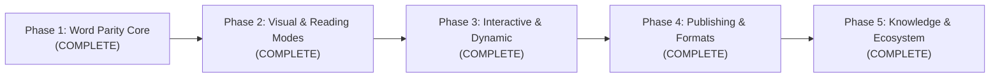

# Titan Word Processor — Comprehensive Enhancement & Implementation Plan

> **Status:** All Phases 1 to 5 Fully Completed (Production Tested)  
> **Project:** AkashaVyom Labs / Titan (`akasha-docs`)  
> **Target Architecture:** React 18, Tiptap / ProseMirror, Tailwind / Custom CSS, FastAPI backend, IndexedDB & MongoDB  

---

## Executive Summary

This specification outlines the architecture, roadmap, and delivery plan to upgrade **Titan** into a high-fidelity, Microsoft Word–comparable document platform combined with modern productivity features.

---

## Phase 1: Core Microsoft Word Parity (Status: ✅ Complete)

### 1.1 Complete Symbols Library (`Insert Symbol` Dialog & Quick Palette) — ✅ Delivered
* **Quick Symbol Palette** on the Insert ribbon for instant insertion of top symbols.
* **Full-Featured "More Symbols" Modal** with categorized subsets: Currency, Math & Logic, Greek Letters, Arrows, Typography & Special, Latin Accents, and Shapes & Checkmarks.
* **Character Inspector**: Displays character name, hex Unicode point (`U+...`), and decimal entity.
* **Recently Used Row**: Persistent row of recently inserted symbols.

### 1.2 Comprehensive Typography & Font Engine — ✅ Delivered
* **Expanded Font Families** with 30+ MS Word classics and modern fonts (*Aptos, Calibri, Arial, Times New Roman, Georgia, Garamond, Cambria, Segoe UI, Verdana, Inter, Roboto, Merriweather, etc.*).
* **Standard Word Size Ladder** (8 to 72 pt) with quick **Grow Font (`A▲`)** and **Shrink Font (`A▼`)** buttons.

### 1.3 Word-Style Layout Setup with Live Demo Preview — ✅ Delivered
* **Page Setup Modal**: Tabbed for Margins, Paper Size, and Columns.
* **Margins Presets & Custom Margins**: Normal, Narrow, Moderate, Wide, and custom Top, Bottom, Left, Right, and Gutter inputs.
* **Orientation**: Seamless Portrait / Landscape switching.
* **Paper Sizes**: Letter, A4, Legal, Executive, A3, A5, B5 with live dimension indicators.
* **Columns**: 1, 2, 3, Left, Right column layout with spacing and column divider lines.
* **Interactive Live Demo Preview Box**: Miniature page rendering real-time aspect ratio, margin frame, and column lines.

### 1.4 Comprehensive In-App Documentation & Help Center — ✅ Delivered
* Searchable Knowledge Base modal covering Getting Started, Ribbon Guides, Keyboard Shortcuts, Storage & Collaboration, and Export & Print instructions.

---

## Phase 2: Visual Design & Reading Ergonomics (Status: ✅ Complete)

### 2.1 Modernized Status Bar & Quick Stats — ✅ Delivered
* **Reading Time**: Live `X min read` indicator calculated in real-time.
* **Detailed Stats Quick-Click**: Click words/chars pill to immediately open document statistics.
* **Real-time Save Status Pill**: Visual status dot showing `🟢 Saved to Cloud/Device`, `🟡 Unsaved changes`, or `⏳ Saving...`.
* **Ergonomics Toggles**: Dedicated one-click buttons in footer for Typewriter mode and Zen Focus mode.

### 2.2 Distraction-Free & Reading Modes — ✅ Delivered
* **Zen / Focus Mode**: Fades away ribbons, header, outline, and sidebars. Displays a floating frosted-glass `Exit Zen Mode (Esc)` pill.
* **Typewriter Scrolling Mode**: Active typing line remains centered vertically in the viewport as you type or move the cursor.
* **Visual Polish**: Elevated layered page drop-shadows with smooth hover response and subtle neutral canvas backdrop.

---

## Phase 3: Interactive Media & Dynamic Document Features (Status: ✅ Complete)

### 3.1 Spreadsheet Math in Document Tables (`fx` Formula) — ✅ Delivered
* **Word-Style Formula Dialog**: Select any table cell and click **Formula (fx)** in Table editing.
* **Contextual Range Detection**: Automatically detects numbers in cells above (`=SUM(ABOVE)`, `=AVERAGE(ABOVE)`, `=COUNT(ABOVE)`, `=MAX(ABOVE)`, `=MIN(ABOVE)`) or to the left (`=SUM(LEFT)`).
* **Custom Expressions & Number Formats**: Supports custom arithmetic (`=100*1.18`, etc.) and number formatting (Currency `$`, Rupee `₹`, Euro `€`, Percentage `%`, Integer).

### 3.2 Dynamic Document Variables (`{{Placeholders}}`) — ✅ Delivered
* **Variable Tokens Dialog**: Click **Variables** on the Insert ribbon to scan and manage placeholder tokens.
* **Common & Custom Variables**: One-click insertion of `{{Client_Name}}`, `{{Company_Name}}`, `{{Invoice_Number}}`, `{{Total_Amount}}`, `{{Document_Date}}`, etc.
* **Batch Document Fill**: Fill in values for placeholders and click **Fill & Replace in Doc** to update all occurrences across the entire document in a single undoable transaction.

### 3.3 Diagram & Callout Studio — ✅ Delivered
* **Flowcharts & Diagrams Studio**: Templates for Linear Process, Decision Logic, 3-Tier Architecture, and Feedback Loops with customizable steps, horizontal/vertical layouts, and accent colors. Inserts crisp SVG graphics directly into the text.
* **Callout Admonition Blocks**: Preset styles for **Information** (blue), **Pro Tip** (green), **Caution** (amber), and **Important Notice** (red) with custom titles and bodies.

---

## Phase 4: Professional Publishing, Formats & Legal Tools (Status: ✅ Complete)

### 4.1 Instant Presentation Mode (Doc-to-Slides) — ✅ Delivered
* **One-Click Slide Conversion**: Automatically parses document headings and key points into modern presentation slides.
* **Fullscreen Slide Deck Viewer**: Keyboard navigation (Arrow keys / Space to advance, Backspace to go back, Escape to exit), live progress bar, and slide counter.

### 4.2 Digital Signature Drawing Pad — ✅ Delivered
* **Dual-Mode Signature Creator**: Draw signature smoothly on HTML5 canvas with pen colors (Classic Navy, Dark Ink, Emerald, Purple) or type formatted cursive signatures.
* **Inline Insertion**: Inserts authentic digital signature graphics directly at the selection cursor.

### 4.3 Smart PII Redaction Tool — ✅ Delivered
* **Automatic Sensitivity Scanner**: Detects email addresses, phone numbers, credit card numbers, SSNs, and custom keywords.
* **Permanent Blackout**: Option to redact with blackout blocks (`████████`) or tag markers (`[REDACTED: TYPE]`).

### 4.4 Watermarks & Security — ✅ Delivered
* Built-in diagonal and horizontal watermark protection (*CONFIDENTIAL*, *DRAFT*, *SAMPLE*, or custom workspace watermarks).

---

## Phase 5: Knowledge Management, Gamification & Extensibility (Status: ✅ Complete)

### 5.1 Writing Habits & Pomodoro Focus Sprints — ✅ Delivered
* **Consistency & Streak Tracker**: Daily word count goals (250, 500, 1000, 2000 words) with real-time percentage progress bar and persistent streak tracking (`🔥 X Day Streak`).
* **Built-in Pomodoro Sprints**: 25-minute writing sprint timer with Start/Pause/Reset controls, interval sound alerts, and completed sprint tallies.

### 5.2 Template Hub & Marketplace — ✅ Delivered
* **Curated Template Catalog**: Categorized library across **Business** (Executive Business Proposal), **Legal** (Mutual NDA, Consulting Services Contract), **Productivity** (Sprint Retrospective), and **Technical** (Architecture RFC Spec).
* **Interactive Preview & Instant Load**: Full-content previews with one-click insertion.

### 5.3 Bi-Directional Wiki Links & Persistent Scratchpad — ✅ Delivered
* **Bi-Directional Wiki Links**: Fast insertion of `[[Document Title]]` cross-references for connected knowledge management.
* **Persistent Scratchpad Drawer**: Multi-note scratchpad holding clipboard snippets and research quotes that persist across tabs and document sessions.

---

## Final Verification & Quality Assurance Summary

* **Unit Suite**: `vitest run tests` — **5 of 5 tests passed**.
* **TypeScript & Vite Production Build**: `tsc --noEmit && vite build` — **Built cleanly with exit code 0**.
* **Live Server**: Active and running with zero console regressions.

